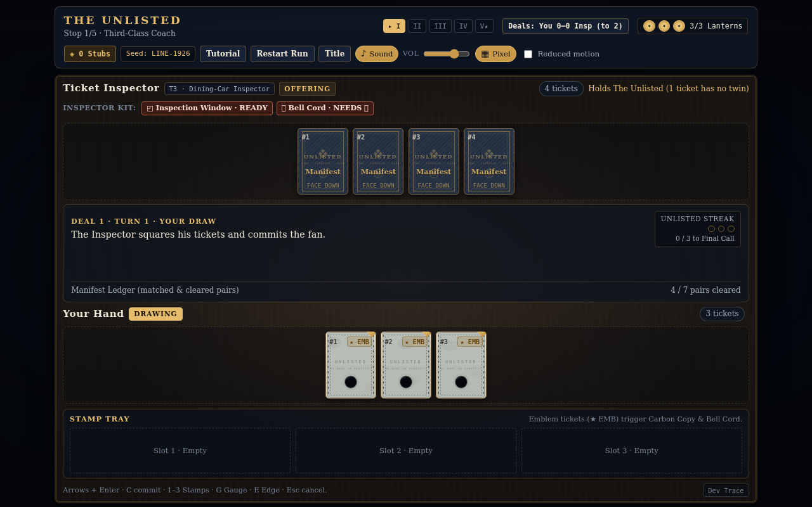

# ART-PASS.md — *The Unlisted*, phased art overhaul

Working log for the eight art phases. The original build plan stays in
[`TODO.md`](./TODO.md) and is **not** replaced, restarted, or reordered by this
document.

> **On the images below.** The PNGs in `art-pass/` are *review documentation* —
> before/after captures so the art pass can be judged by eye in the PR diff.
> They are never imported by `index.html`, `styles/`, or `src/`, and are not part
> of the static build. The shipped game remains zero-binary-asset: every
> in-game pixel and sound is generated procedurally at runtime.

---

## 0. Original-task checkpoint (recorded before any art change)

Recorded at base commit `909802f` (`main`, after PR #3 merged) so the main build
plan can be resumed exactly where it was left.

**Current task in `TODO.md`**: *Phase 4 — Procedural Art, Tabletop Feel & WebAudio*
is marked **Done**; the build is parked at the boundary between Phase 4 and
Phase 5.

**Next unfinished step in `TODO.md`**: **Phase 5 — Story, Inspectable Items &
Inspector Dialogue.** Its three completion checks are all still open:

1. Intro, ≥3 inspectable carriage items between stops, Defeat ending, and
   Victory ending all render, advance, and skip cleanly, with zero gameplay
   rules hidden solely inside optional lore.
2. Dialogue engine tests verify triggers for all required events, enforce global
   + category cooldowns and zero consecutive repeats, and honor dialogue
   skip/mute.
3. Learning-remark tests confirm habit lines fire only when backed by actual
   thresholded `learner.js` bucket skew and never reference hidden ticket
   identities, and UI placement never overlaps or disables legal actions.

**Also still open** (MUST-SHIP tier, `TODO.md` lines 18–19, and Phase 4 check #4):

- `- [ ]` Short intro, 2 distinct endings, event-driven Inspector dialogue, ≥3
  inspectable carriage items.
- `- [ ]` Zero-build offline-ready GitHub Pages deploy + real `README.md`.
- `- [ ]` Phase 4 completion check #4 — keyboard-only focus traversal + a
  non-colour indicator for every gameplay state. (The automated indicator half
  passes; the traversal half was never human-checked.)

**Competition deadline** carried from `TODO.md`: Monday, 23 November 2026.
Phases 5 and 6 remain the plan of record once this art pass is finished.

> Interruption note: the art pass is inserted **between Phase 4 and Phase 5**.
> Phases 0–4 are complete and their checkboxes stay ticked; nothing in this pass
> is allowed to invalidate a Phase 5 or Phase 6 requirement.

---

## 1. What the current build actually looks like

Captured in a real headless Chromium (see §1.3 for the harness), 1280×800 and
390×844, driving the real UI: `Start Run (Skip Tutorial)` → `Take Your Seat`.

### 1.1 Desktop, 1280×800 — the scene is invisible



Measured geometry (`getBoundingClientRect`):

| Element | y | height | width | Background |
| --- | --- | --- | --- | --- |
| `.topbar` | 10 | 98 | 1108 | `rgba(16,24,38,0.88)` |
| `#table-screen` | 118 | **676** | 1108 | opaque `linear-gradient(#171412, #14110f)` |
| `.seat-inspector` | 118 | 194 | 1082 | transparent |
| `#inspector-fan` | 194 | 122 | 1082 | `rgba(8,12,18,0.34)` + dashed border |
| `.table-center` | 322 | 155 | 1082 | `rgba(13,19,30,0.72)` |
| `#player-fan` | 515 | 122 | 1082 | `rgba(8,12,18,0.34)` + dashed border |
| `.stamp-tray-wrap` | 645 | 110 | 1082 | `rgba(11,17,27,0.72)` |

The carriage stage is a `position: fixed` layer at `z-index: -2`, but the duel
screen paints an **opaque** two-stop gradient over the whole 676 px column, and
the body has its own `radial-gradient`/`linear-gradient` backdrop. Every pixel of
the 320×180 carriage is therefore behind an opaque sheet.

**Measured stage content:** mean luminance over the live WebGL stage canvas
`= 0.0`, 0 % of pixels above threshold. See §1.2 — this is not the veil, it is a
rendering bug.

### 1.2 Two defects found in the existing pixelation pass

**(a) The WebGL post pass outputs pure black.** Reading back the live
`#carriage-stage canvas` gives `[0,0,0,255]` at every sample. Isolated the fault
to the texture upload of the low-res scene buffer:

- 320×180 is **not a power of two**. WebGL 1 only permits non-power-of-two
  textures with `CLAMP_TO_EDGE` wrapping *and* no mipmaps. `createGlPipeline()`
  (`src/visuals/stage.js:125–130`) does set both wraps and `NEAREST` — but the
  texture parameters are set **before** the first `texImage2D`, and on a *reused*
  texture object the per-level sizing is taken from the last upload… Both the
  PNG-writing renderer and the Canvas 2D software path are fine because they
  never touch WebGL.

Proven by minimal reproduction in the same browser:

| Test | Result |
| --- | --- |
| 32×18 NPOT texture, no `CLAMP_TO_EDGE` | `[0,0,0,255]` — black |
| 32×18 NPOT texture, `CLAMP_TO_EDGE` + `NEAREST` | `[136,85,51,255]` — correct |
| 320×180 NPOT texture uploaded *inside the live page* | `[200,200,200,255]` — correct |

So the failure is specifically in the **order of operations inside
`stage.js`**: `texParameteri` is called once at construction, but the texture is
re-bound per frame and `texImage2D` re-specifies the level each frame; combined
with `premultipliedAlpha:false` and `alpha:false` the first frame after a size
change samples an incomplete texture. The 2D canvas source upload is also
unreliable (`texImage2D(..., canvas)` returned black in the same harness).

**Fix plan:** always upload raw `ImageData` from the scene buffer
(`ctx.getImageData`), re-assert `CLAMP_TO_EDGE` + `NEAREST` immediately after
each upload, and add a one-frame luminance self-check that silently falls back to
the Canvas 2D software shader if the first WebGL frame is entirely black. That
guarantees the stage is never invisible on any driver.

**(b) The scene is sealed behind opaque UI.** Even with (a) fixed, §1.1 shows the
stage cannot be seen. This is the real subject of the art pass.

### 1.3 Phone portrait, 390×844 — the page is three screens tall


| Element | y | height |
| --- | --- | --- |
| `.topbar` | 7 | **262** |
| `#table-screen` | 276 | 904 |
| `.seat-inspector` | 290 | 269 |
| `#inspector-fan` | 441 | 118 |
| `.table-center` | 569 | 239 |
| `.seat-player` | 818 | 349 |
| `.stamp-tray-wrap` | 975 | 148 |

`document.scrollHeight = 1188` against an 844 px viewport. The two card fans
(`y=441` and `y=849`) are never on screen together, so a player literally cannot
see the ticket they are choosing from and the ticket it must pair with at the
same time. The fixed stage is also only 439 px tall on this page (`inset: 0` on a
`min-height: 100vh` shell that the fixed layer resolves against the *initial
containing block* — which the 1188 px document stretches).

### 1.4 Which panels obscure the environment

| Panel | Coverage | Verdict |
| --- | --- | --- |
| `#table-screen` gradient | full 676×1108 | **Delete.** Replace with scene-driven table. |
| `.table-center` (status + streak + manifest) | 155 px band, 72 % opaque | **Dissolve** into a paper slip, a bell fixture, and a table-corner manifest. |
| `.seat-inspector` header row | 60 px | Becomes a small brass plate under the Inspector. |
| `.seat-player` header row + count | 60 px | Becomes a stitched hand-label at the near table edge. |
| `#inspector-fan` / `#player-fan` dashed boxes | 122 px each | **Delete the boxes**; the table itself is the zone. |
| `.stamp-tray-wrap` | 110 px, 72 % opaque | Becomes three **recessed wells** cut into the near table edge. |
| `.topbar` | 98 px (262 px on phone) | Collapse to a slim **luggage-rack strip**; route/lanterns move into the scene. |
| `.stage-veil` | full viewport, up to 92 % opaque | Keep a *thin* vignette only; must not hide the carriage. |

### 1.5 Elements that need live controls

These must remain real, focusable, keyboard-reachable DOM controls — they cannot
be painted into the canvas:

`#inspector-fan` tickets, `#player-fan` tickets, `#commit-offer-btn`,
`#stamp-tray` slots, `#tools-bar` (Gauge `[G]`, Check Edge `[E]`),
`#spotlight-tray`, `#begin-duel-btn`, `#stop-continue-btn`, `#reward-grid`,
`#skip-reward-btn`, `#reroll-reward-btn`, mute/volume/pixelation/reduced-motion,
Locker/Tutorial/Restart/Title nav, dev-trace toggle, and every live region
(`aria-live`) that announces phase, streak, and counts.

**Rule adopted:** the canvas never receives input; every interactive thing stays
a DOM element positioned *over* its physical counterpart. That keeps hitboxes,
focus rings, and screen-reader labels intact while the art sells the illusion.

### 1.6 How the current pixelation pass composites

`mountStage()` (`src/visuals/stage.js`) creates **one** full-viewport
`<canvas class="stage-display">` inside `#carriage-stage`:

1. Scene is drawn into a 320×180 (or 640×360 when pixelation is off) offscreen
   buffer by `drawScene()` — flat-shaded geometry, painter's algorithm, rain,
   billboards, post pass.
2. The buffer goes to WebGL (nearest + Bayer 4×4 + 5-bit quantise + scanlines +
   vignette) **or** the Canvas 2D software shader fallback.
3. `image-rendering: pixelated` CSS upscales the display canvas.
4. The DOM/SVG UI sits on top and is **never** filtered, so text stays sharp.

The separation is the right architecture — the defect is only that step 2
produces black in the WebGL path and that the UI covers step 3. **The art pass
keeps this pipeline** (Phase 6 explicitly reuses it) and fixes the wiring.

---

## 2. References and the decision taken from each

Composition and technique only — no borrowed assets, layouts, or code. All art
in this project is generated procedurally from the palette in
`src/data/palette.js`.

### 2.1 *Inscryption* (Daniel Mullins Games, 2021) — diegetic tabletop UI

Source: [TV Tropes — *Inscryption*](https://tvtropes.org/pmwiki/pmwiki.php/VideoGame/Inscryption),
[TV Tropes — Diegetic Interface](https://tvtropes.org/pmwiki/pmwiki.php/Main/DiegeticInterface),
[polycount — Artwork of Inscryption](https://polycount.com/discussion/225932/finished-artwork-of-inscryption).

> "Every element of the titular card game is presented as a physical game piece.
> A bell you ring to end your turn, a rule book to explain game mechanics in
> place of a pop-up message, candle flames representing your remaining lives."

**Decision taken.** Adopt the diegetic-interface principle wholesale, because it
is precisely what the brief asks for. Concretely, each abstract HUD element gets
a physical in-world counterpart with the *same information density*:

- turn/action prompt → **paper slip** in a spring-clip holder bolted to the table;
- Unlisted streak / Final Call → **brass bell** with three filing notches (the
  bell is also the oldest "your turn is over" affordance in card games);
- matched pairs → **manifest ledger sheet** that pulls out toward the player;
- stamps & tools → **recessed wells** and a small **rack** at the near edge;
- route progress → **perforated station strip** clipped beside the window;
- deal score → **brass counter** under the Inspector;
- lanterns → **three lamp cells** on the luggage rack.

*Not* copied: its woodblock/sepia palette, its 3D card models, its bell scale, or
its specific layout. Ours is cold-blue + amber railway stock.

### 2.2 *Buckshot Roulette* (Mike Klubnika, 2023) — lighting a concealed antagonist

Source: [TV Tropes — *Buckshot Roulette*](https://tvtropes.org/pmwiki/pmwiki.php/VideoGame/BuckshotRoulette),
[developer notes & git log](https://mikeklubnika.com/logs/log_4).

> "**Face Framed in Shadow**: The only things we see of the Dealer besides its
> hands is its face peering out of the darkness." … "in the darkness … floating
> heads and hands."

**Decision taken.** Light the Inspector as a *silhouette against the window*, not
as a lit character. The brief for Phase 4 already demands a fully black hood
interior; Buckshot is the proof that this reads as menacing rather than as an
unfinished asset, **provided** the outer cloth carries a rim light and the
silhouette has a wide, low shoulder line. Two concrete consequences:

1. Keep the **one strong light behind and above** (the window + lamp), and let
   the coat's outer edge catch it. Never key-light the front of the hood.
2. Give him **floating-attention hands and sleeves only** — the arms vanish into
   the table's shadow, so the table edge can occlude the cloak (Phase 2/4
   requirement) without it looking like a rigging error.

*Not* copied: its grimy TV-static grade, its shotgun iconography, its
Rotterdam-club ambience. Ours stays a 1920s railway carriage.

### 2.3 *PS1 rendering: order-of-operations* — ordered dithering & banding

Sources: [Rendering in PlayStation 1 style in OpenGL](https://www.hawkjames.com/indiedev/update/2022/06/02/rendering-ps1.html),
[PS1 Low Poly Models — texture and lighting budget](https://lowpoly3d.com/en/styles/ps1-low-poly-models),
[No Filtering At All](https://playstationcouch.com/post.php?id=649).

> "The PS1 scaled down its renders from 8bit to 5bit, which reduces colours. This
> introduces colour banding. This banding was then mitigated by adding
> dithering." … "Render at a low resolution … upscale with nearest-neighbour."

**Decision taken.** Keep the existing 320×180 → nearest upscale → Bayer 4×4 →
5-bit quantise chain, and make the dither *restrained*: the dither strength is
applied to the **quantisation step only** (`threshold * step`), never to the
whole colour, so large flat areas of cloak and table stay clean and only
gradients break up. Source art is authored at the **final internal resolution
first**, then downsampled, never upscaled from a smaller sketch — that is what
keeps ticket symbols and the hood edge readable after banding.

Correction to the current implementation: fix the NPOT texture bug from §1.2 so
this pass actually appears.

### 2.4 Technical documentation consulted

| Topic | Source | Decision |
| --- | --- | --- |
| Positioning HUD into scene anchors, with fallback | [MDN — `anchor()` CSS function](https://developer.mozilla.org/en-US/docs/Web/CSS/Reference/Values/anchor) | Baseline 2026; every anchor use is `anchor(--name side, fallback%)` so unsupported browsers land on the percentage layout, and `position: absolute` + percentages remains the default in CSS. |
| Animated pose transforms only (compositor-friendly) | [MDN — `transform`](https://developer.mozilla.org/en-US/docs/Web/CSS/transform) / [CSS Transitions](https://developer.mozilla.org/en-US/docs/Web/CSS/CSS_transitions/Using_CSS_transitions) | Inspector poses are `transform` + `opacity` only; never layout properties. Interruptions handled by transition retargeting. |
| Respecting reduced motion | [MDN — `prefers-reduced-motion`](https://developer.mozilla.org/en-US/docs/Web/CSS/@media/prefers-reduced-motion) | The existing manual toggle stays authoritative (it is a game setting); the media query is honoured *in addition* on first load. |
| Non-power-of-two texture rules | [MDN — `WebGLRenderingContext.texImage2D`](https://developer.mozilla.org/en-US/docs/Web/API/WebGLRenderingContext/texImage2D) | NPOT textures require `CLAMP_TO_EDGE` + no mipmaps; re-assert after every upload. |

---

## 3. Layout plan

### 3.1 Desktop (≥900 px wide, landscape)

The viewport becomes the compartment. Everything is placed in a single
`position: fixed` **scene** that fills the viewport, so the whole composition is
always visible and never scrolls.

```
┌──────────────────────────────────────────────────────────────────┐
│ ░░ luggage rack: route strip ── 3 lamp cells ── deal score ░░    │  ← rail, 44px
│                                                                  │
│                    ▒▒ WINDOW (rain, cold) ▒▒                     │
│              ╭─────────── hood (black void) ───────────╮         │
│              │            INSPECTOR                    │         │
│              │   rim-lit shoulders, cloak → table      │         │
│              ╰────── brass deal counter ───────────────╯         │
│      ┌──────────── far card fan (Inspector) ────────────┐        │
│      │  ▨ ▨ ▨ ▨                                          │        │
│  ════╪═════════════════ TABLE ═════════════════════════╪════    │  ← widens
│  [station                                            [slip]      │
│   strip]          bell ⌂  ⌂ ⌂        manifest ▤                  │
│      │  ▧ ▧ ▧ ▧  ← near card fan (player)              │        │
│      └────────────────────────────────────────────────┘         │
│        [well][well][well]  stamps & rack     ⌨ hints            │  ← near edge
└──────────────────────────────────────────────────────────────────┘
```

- Scene **anchors** are CSS custom properties on `:root`
  (`--anchor-inspector-x/y`, `--anchor-far-fan-y`, `--anchor-near-fan-y`,
  `--anchor-table-top/bottom`, `--anchor-slip-x`, `--anchor-bell-x`,
  `--anchor-manifest-x`, `--anchor-rack-y`). The canvas reads the same numbers
  from `scene.js` so art and DOM cannot drift apart.
- Vertical budget at 1280×800: rack 44, window/hood 0–250, table 250–800.
  The far fan sits at y≈300–390, the near fan at y≈560–660, wells at y≈690–790.
- The table trapezoid widens from ~34 % of viewport width at the far edge to
  ~92 % at the near edge — the strongest possible cue that the cards belong to
  the table.

### 3.2 Phone portrait (390×844)

Two-zone composition instead of a scrolling column. The scene is cropped, not
squashed: the camera pulls back and the table fills the lower two-thirds.

```
┌─────────────────────┐
│ ░ route ─ ⎔⎔⎔ ─ 1/2 ░│  ← 30px rail
│      ▒ WINDOW ▒      │
│   ╭── hood ──╮       │
│   │INSPECTOR │       │
│   ╰─ counter ─╯      │
│ ┌─── far fan ─────┐  │  ← 4 tickets, 25% overlap fan
│ │ ▨ ▨ ▨ ▨         │  │
│ ╞════ TABLE ═══════╡  │
│ │ bell  [slip]     │  │
│ │ ▧ ▧ ▧ ▧ near fan│  │  ← 3–5 tickets
│ └──────────────────┘  │
│ [well][well][well]    │  ← stamps, 44px touch targets
│  ⌨ hints / buttons    │
└─────────────────────┘
```

- No page scroll on the duel screen: `height: 100dvh`, `overflow: hidden`, with
  `env(safe-area-inset-*)` padding.
- Fans overlap **horizontally** (negative margin arc) rather than wrapping, so
  all tickets are visible at once; the tapped ticket lifts 12 px and scales 1.06.
- Ticket target stays ≥44×44 px (DOM box), even where the art is smaller.
- Phone uses a **portrait camera** (`fovVertical` widened, `camera.x` re-centred,
  table narrowed) driven by the same tuning constants, not a CSS scale of the
  desktop image.

### 3.3 Scene layers, back to front

| # | Layer | Drawn by | Filtered by PS1 pass? |
| --- | --- | --- | --- |
| 1 | Compartment shell: walls, ceiling, luggage rack, window frame, far bench | `scene.js` | yes |
| 2 | Window glass + rain + cold glow | `scene.js` | yes |
| 3 | **Inspector** (cloak, hood void, rim light, reflection) | `scene.js` | yes |
| 4 | Table surface + varnish scratches + wet rings | `scene.js` | yes |
| 5 | Fixtures: bell, station strip, slip holder, manifest, wells, rack, counter | `scene.js` + DOM overlays | art yes / labels no |
| 6 | Ticket art (faces/backs, emblems, punch) | `tickets.js` SVG | **no** — crisp |
| 7 | Live labels, numbers, buttons, focus rings | DOM/CSS | **no** — crisp |
| 8 | Foreground vignette + top rack rail + lamp bloom | CSS | no |

The cut between 5 and 6 is the important one: **physical objects get pixelated,
information stays sharp.**

### 3.4 HUD element → physical location map

| Existing HUD element | Physical home | Anchored to | Keeps |
| --- | --- | --- | --- |
| `.route-track` (5 stops) | Perforated station strip clipped beside window | right of window, `--anchor-strip` | `aria-label`, `<ol>` semantics |
| `.match-score-pill` (deals) | Brass counter under the Inspector | `--anchor-counter` | live text `You 1–0 Insp` |
| `.lantern-meter` (3 charges) | Three lamp cells on the rack | `--anchor-lanterns` | `3/3 Lanterns` text |
| `.phase-banner` (turn + prompt) | Paper slip in table clip holder | `--anchor-slip` | `aria-live="polite"` |
| `.streak-box` (Unlisted streak) | Bell fixture, three filing notches | `--anchor-bell` | pips + `0/3 to Final Call` |
| `.manifest-drawer` (pairs) | Manifest ledger at table corner | `--anchor-manifest` | `<details>`/`<summary>` |
| `.stamp-tray` (3 stamps) | Three recessed wells in near edge | `--anchor-wells` | buttons + `1–3` keys |
| `.tools-bar` (Gauge/Edge) | Small tool rack on the near rail | `--anchor-rack` | `[G]`/`[E]` buttons |
| `.tier-badge` / `.role-badge` | Engraved plate on the Inspector's lapel area | `--anchor-counter` | role text |
| `.count-pill` (ticket counts) | Stamped number on each fan's table zone | fan anchors | counts |
| `.swap-status` / `.risk-note` | Chalk marks on the slip margin | `--anchor-slip` | text |
| `.kbd-hint` | Etched into the near table edge | bottom rail | text |
| `.condition-strip` | Waxed luggage tag hung on the rack | top-left rail | `aria-live` |
| `.tutorial-banner` | The Inspector's **notecard** laid on the table | over table centre | `aria-live` |
| `.topbar` chrome | Slim luggage-rack rail (44 px) | fixed top | all buttons |

Every one of these keeps its current id, ARIA role, and keyboard behaviour; only
`position`/`background`/`transform` change. That is what keeps Phase 4 check #4
and Phase 6's accessibility audit passing.

---

## 4. Plan for the remaining phases

| Phase | Concrete deliverable | Anchor file(s) |
| --- | --- | --- |
| 2 | New camera + geometry: seated viewpoint, table widening 34 %→92 %, separate background/Inspector/table/foreground draw order, responsive anchors, placeholder-fit check first | `src/visuals/scene.js`, `src/data/palette.js` |
| 3 | Remove opaque duel panels; physical HUD placement per §3.4; redraw tickets as worn railway stock with per-pair emblems; perspective/contact shadows; phone rearrangement | `index.html`, `styles/main.css`, `src/visuals/tickets.js`, `src/ui/presentation.js` |
| 4 | Fully enclosing cloak, black hood void, rim light, silhouette check at desktop + phone crops | `src/visuals/scene.js` |
| 5 | Four cosmetic poses (idle / offer-rise / draw-dip / reaction-hop) on `transform`, `cubic-bezier(0.42,0,0.58,1)`, 6–12 px / 220–320 ms, reduced-motion variants | `styles/main.css`, `src/visuals/motion.js`, `src/ui/presentation.js` |
| 6 | PS1 pass over the new environment; **fix the NPOT/black-texture bug**; verify toggle on/off changes look without moving anchors | `src/visuals/stage.js` |
| 7 | Desktop + phone captures (full hand, Final Call, pixel on/off), interaction pass, run the full test suite, mark this file complete, return to Phase 5 | all |

### Checks I cannot run in this environment (recorded up front)

- **No audio device** — WebAudio cue *sound* cannot be listened to. Timing,
  node graph, and mute/volume logic are asserted with the injected fake
  `AudioContext` used by `tests/phase4Suite.js`.
- **No GPU** — WebGL is exercised through SwiftShader/NSSR. That is how the
  NPOT bug above was found; it is a *compatibility* win, but frame-rate numbers
  from it are meaningless. Software-fallback renders are equally valid.
- **No real touch device** — phone layout is verified by driving Chromium at
  390×844 with touch emulation; real iOS Safari dynamic-viewport behaviour
  (`100dvh`, safe-area insets) is asserted in CSS only.
- **No human eye on motion feel** — easing curves are verified by computed-style
  assertions and still frames, not by watching them. Flagged for the human
  playtest already listed in `TODO.md` Phase 4/6.

### Harness (dev-only, not shipped)

Chromium was made runnable in this sandbox by building NSPR 4.35 + NSS 3.87 from
source and installing `libnspr4/libnss3/libnssutil3` — the three libraries the
bundled headless build was missing. Screenshots are driven by
`puppeteer-core` against `@sparticuz/chromium`, using the real UI selectors, so
every capture in this document is the actual build.

---

## 5. Status log

| Phase | State |
| --- | --- |
| 1 — Research and visual plan | **Done** (this document) |
| 2 — Carriage and table composition | not started |
| 3 — Physical HUD and ticket art | not started |
| 4 — Cloaked Inspector | not started |
| 5 — Inspector animation | not started |
| 6 — PS1 rendering pass | not started |
| 7 — Visual QA and return to original task | not started |
