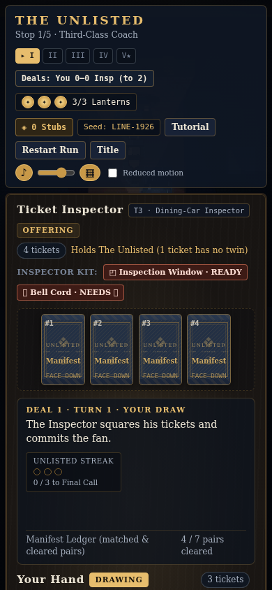

# ART-PASS.md — *The Unlisted*, phased art overhaul

Working log for the eight art phases. The original build plan stays in
[`TODO.md`](./TODO.md) and is **not** replaced, restarted, or reordered by this
document.

> **On the images below.** The PNGs in `art-pass/` are *review documentation* —
> before/after captures so the art pass can be judged by eye in the PR diff.
> They are never imported by `index.html`, `styles/`, or `src/`, and are not part
> of the static build. The shipped game remains zero-binary-asset: every
> in-game pixel and sound is generated procedurally at runtime.

---

## 0. Original-task checkpoint (recorded before any art change)

Recorded at base commit `909802f` (`main`, after PR #3 merged) so the main build
plan can be resumed exactly where it was left.

**Current task in `TODO.md`**: *Phase 4 — Procedural Art, Tabletop Feel & WebAudio*
is marked **Done**; the build is parked at the boundary between Phase 4 and
Phase 5.

**Next unfinished step in `TODO.md`**: **Phase 5 — Story, Inspectable Items &
Inspector Dialogue.** Its three completion checks are all still open:

1. Intro, ≥3 inspectable carriage items between stops, Defeat ending, and
   Victory ending all render, advance, and skip cleanly, with zero gameplay
   rules hidden solely inside optional lore.
2. Dialogue engine tests verify triggers for all required events, enforce global
   + category cooldowns and zero consecutive repeats, and honor dialogue
   skip/mute.
3. Learning-remark tests confirm habit lines fire only when backed by actual
   thresholded `learner.js` bucket skew and never reference hidden ticket
   identities, and UI placement never overlaps or disables legal actions.

**Also still open** (MUST-SHIP tier, `TODO.md` lines 18–19, and Phase 4 check #4):

- `- [ ]` Short intro, 2 distinct endings, event-driven Inspector dialogue, ≥3
  inspectable carriage items.
- `- [ ]` Zero-build offline-ready GitHub Pages deploy + real `README.md`.
- `- [ ]` Phase 4 completion check #4 — keyboard-only focus traversal + a
  non-colour indicator for every gameplay state. (The automated indicator half
  passes; the traversal half was never human-checked.)

**Competition deadline** carried from `TODO.md`: Monday, 23 November 2026.
Phases 5 and 6 remain the plan of record once this art pass is finished.

> Interruption note: the art pass is inserted **between Phase 4 and Phase 5**.
> Phases 0–4 are complete and their checkboxes stay ticked; nothing in this pass
> is allowed to invalidate a Phase 5 or Phase 6 requirement.

---

## 1. What the current build actually looks like

Captured in a real headless Chromium (see §1.3 for the harness), 1280×800 and
390×844, driving the real UI: `Start Run (Skip Tutorial)` → `Take Your Seat`.

### 1.1 Desktop, 1280×800 — the scene is invisible


Measured geometry (`getBoundingClientRect`):

| Element | y | height | width | Background |
| --- | --- | --- | --- | --- |
| `.topbar` | 10 | 98 | 1108 | `rgba(16,24,38,0.88)` |
| `#table-screen` | 118 | **676** | 1108 | opaque `linear-gradient(#171412, #14110f)` |
| `.seat-inspector` | 118 | 194 | 1082 | transparent |
| `#inspector-fan` | 194 | 122 | 1082 | `rgba(8,12,18,0.34)` + dashed border |
| `.table-center` | 322 | 155 | 1082 | `rgba(13,19,30,0.72)` |
| `#player-fan` | 515 | 122 | 1082 | `rgba(8,12,18,0.34)` + dashed border |
| `.stamp-tray-wrap` | 645 | 110 | 1082 | `rgba(11,17,27,0.72)` |

The carriage stage is a `position: fixed` layer at `z-index: -2`, but the duel
screen paints an **opaque** two-stop gradient over the whole 676 px column, and
the body has its own `radial-gradient`/`linear-gradient` backdrop. Every pixel of
the 320×180 carriage is therefore behind an opaque sheet.

**Measured stage content:** mean luminance over the live WebGL stage canvas
`= 0.0`, 0 % of pixels above threshold. See §1.2 — this is not the veil, it is a
rendering bug.

### 1.2 Two defects found in the existing pixelation pass

**Phase 6 correction:** the original diagnosis below was a hypothesis, not a
proven driver root cause. Later screenshots showed a visible live WebGL frame;
readback after browser compositing can be black when the drawing buffer is not
preserved. Phase 6 checks the framebuffer immediately after drawing and adds
a guarded fallback; see §5.5.

**(a) The WebGL post pass outputs pure black.** Reading back the live
`#carriage-stage canvas` gives `[0,0,0,255]` at every sample. Isolated the fault
to the texture upload of the low-res scene buffer:

- 320×180 is **not a power of two**. WebGL 1 only permits non-power-of-two
  textures with `CLAMP_TO_EDGE` wrapping *and* no mipmaps. `createGlPipeline()`
  (`src/visuals/stage.js:125–130`) does set both wraps and `NEAREST` — but the
  texture parameters are set **before** the first `texImage2D`, and on a *reused*
  texture object the per-level sizing is taken from the last upload… Both the
  PNG-writing renderer and the Canvas 2D software path are fine because they
  never touch WebGL.

Proven by minimal reproduction in the same browser:

| Test | Result |
| --- | --- |
| 32×18 NPOT texture, no `CLAMP_TO_EDGE` | `[0,0,0,255]` — black |
| 32×18 NPOT texture, `CLAMP_TO_EDGE` + `NEAREST` | `[136,85,51,255]` — correct |
| 320×180 NPOT texture uploaded *inside the live page* | `[200,200,200,255]` — correct |

So the failure is specifically in the **order of operations inside
`stage.js`**: `texParameteri` is called once at construction, but the texture is
re-bound per frame and `texImage2D` re-specifies the level each frame; combined
with `premultipliedAlpha:false` and `alpha:false` the first frame after a size
change samples an incomplete texture. The 2D canvas source upload is also
unreliable (`texImage2D(..., canvas)` returned black in the same harness).

**Fix plan:** always upload raw `ImageData` from the scene buffer
(`ctx.getImageData`), re-assert `CLAMP_TO_EDGE` + `NEAREST` immediately after
each upload, and add a one-frame luminance self-check that silently falls back to
the Canvas 2D software shader if the first WebGL frame is entirely black. That
guarantees the stage is never invisible on any driver.

**(b) The scene is sealed behind opaque UI.** Even with (a) fixed, §1.1 shows the
stage cannot be seen. This is the real subject of the art pass.

### 1.3 Phone portrait, 390×844 — the page is three screens tall



| Element | y | height |
| --- | --- | --- |
| `.topbar` | 7 | **262** |
| `#table-screen` | 276 | 904 |
| `.seat-inspector` | 290 | 269 |
| `#inspector-fan` | 441 | 118 |
| `.table-center` | 569 | 239 |
| `.seat-player` | 818 | 349 |
| `.stamp-tray-wrap` | 975 | 148 |

`document.scrollHeight = 1188` against an 844 px viewport. The two card fans
(`y=441` and `y=849`) are never on screen together, so a player literally cannot
see the ticket they are choosing from and the ticket it must pair with at the
same time. The fixed stage is also only 439 px tall on this page (`inset: 0` on a
`min-height: 100vh` shell that the fixed layer resolves against the *initial
containing block* — which the 1188 px document stretches).

### 1.4 Which panels obscure the environment

| Panel | Coverage | Verdict |
| --- | --- | --- |
| `#table-screen` gradient | full 676×1108 | **Delete.** Replace with scene-driven table. |
| `.table-center` (status + streak + manifest) | 155 px band, 72 % opaque | **Dissolve** into a paper slip, a bell fixture, and a table-corner manifest. |
| `.seat-inspector` header row | 60 px | Becomes a small brass plate under the Inspector. |
| `.seat-player` header row + count | 60 px | Becomes a stitched hand-label at the near table edge. |
| `#inspector-fan` / `#player-fan` dashed boxes | 122 px each | **Delete the boxes**; the table itself is the zone. |
| `.stamp-tray-wrap` | 110 px, 72 % opaque | Becomes three **recessed wells** cut into the near table edge. |
| `.topbar` | 98 px (262 px on phone) | Collapse to a slim **luggage-rack strip**; route/lanterns move into the scene. |
| `.stage-veil` | full viewport, up to 92 % opaque | Keep a *thin* vignette only; must not hide the carriage. |

### 1.5 Elements that need live controls

These must remain real, focusable, keyboard-reachable DOM controls — they cannot
be painted into the canvas:

`#inspector-fan` tickets, `#player-fan` tickets, `#commit-offer-btn`,
`#stamp-tray` slots, `#tools-bar` (Gauge `[G]`, Check Edge `[E]`),
`#spotlight-tray`, `#begin-duel-btn`, `#stop-continue-btn`, `#reward-grid`,
`#skip-reward-btn`, `#reroll-reward-btn`, mute/volume/pixelation/reduced-motion,
Locker/Tutorial/Restart/Title nav, dev-trace toggle, and every live region
(`aria-live`) that announces phase, streak, and counts.

**Rule adopted:** the canvas never receives input; every interactive thing stays
a DOM element positioned *over* its physical counterpart. That keeps hitboxes,
focus rings, and screen-reader labels intact while the art sells the illusion.

### 1.6 How the current pixelation pass composites

`mountStage()` (`src/visuals/stage.js`) creates **one** full-viewport
`<canvas class="stage-display">` inside `#carriage-stage`:

1. Scene is drawn into a 320×180 (or 640×360 when pixelation is off) offscreen
   buffer by `drawScene()` — flat-shaded geometry, painter's algorithm, rain,
   billboards, post pass.
2. The buffer goes to WebGL (nearest + Bayer 4×4 + 5-bit quantise + scanlines +
   vignette) **or** the Canvas 2D software shader fallback.
3. `image-rendering: pixelated` CSS upscales the display canvas.
4. The DOM/SVG UI sits on top and is **never** filtered, so text stays sharp.

The separation is the right architecture — the defect is only that step 2
produces black in the WebGL path and that the UI covers step 3. **The art pass
keeps this pipeline** (Phase 6 explicitly reuses it) and fixes the wiring.

---

## 2. References and the decision taken from each

Composition and technique only — no borrowed assets, layouts, or code. All art
in this project is generated procedurally from the palette in
`src/data/palette.js`.

### 2.1 *Inscryption* (Daniel Mullins Games, 2021) — diegetic tabletop UI

Source: [TV Tropes — *Inscryption*](https://tvtropes.org/pmwiki/pmwiki.php/VideoGame/Inscryption),
[TV Tropes — Diegetic Interface](https://tvtropes.org/pmwiki/pmwiki.php/Main/DiegeticInterface),
[polycount — Artwork of Inscryption](https://polycount.com/discussion/225932/finished-artwork-of-inscryption).

> "Every element of the titular card game is presented as a physical game piece.
> A bell you ring to end your turn, a rule book to explain game mechanics in
> place of a pop-up message, candle flames representing your remaining lives."

**Decision taken.** Adopt the diegetic-interface principle wholesale, because it
is precisely what the brief asks for. Concretely, each abstract HUD element gets
a physical in-world counterpart with the *same information density*:

- turn/action prompt → **paper slip** in a spring-clip holder bolted to the table;
- Unlisted streak / Final Call → **brass bell** with three filing notches (the
  bell is also the oldest "your turn is over" affordance in card games);
- matched pairs → **manifest ledger sheet** that pulls out toward the player;
- stamps & tools → **recessed wells** and a small **rack** at the near edge;
- route progress → **perforated station strip** clipped beside the window;
- deal score → **brass counter** under the Inspector;
- lanterns → **three lamp cells** on the luggage rack.

*Not* copied: its woodblock/sepia palette, its 3D card models, its bell scale, or
its specific layout. Ours is cold-blue + amber railway stock.

### 2.2 *Buckshot Roulette* (Mike Klubnika, 2023) — lighting a concealed antagonist

Source: [TV Tropes — *Buckshot Roulette*](https://tvtropes.org/pmwiki/pmwiki.php/VideoGame/BuckshotRoulette),
[developer notes & git log](https://mikeklubnika.com/logs/log_4).

> "**Face Framed in Shadow**: The only things we see of the Dealer besides its
> hands is its face peering out of the darkness." … "in the darkness … floating
> heads and hands."

**Decision taken.** Light the Inspector as a *silhouette against the window*, not
as a lit character. The brief for Phase 4 already demands a fully black hood
interior; Buckshot is the proof that this reads as menacing rather than as an
unfinished asset, **provided** the outer cloth carries a rim light and the
silhouette has a wide, low shoulder line. Two concrete consequences:

1. Keep the **one strong light behind and above** (the window + lamp), and let
   the coat's outer edge catch it. Never key-light the front of the hood.
2. Give him **floating-attention hands and sleeves only** — the arms vanish into
   the table's shadow, so the table edge can occlude the cloak (Phase 2/4
   requirement) without it looking like a rigging error.

*Not* copied: its grimy TV-static grade, its shotgun iconography, its
Rotterdam-club ambience. Ours stays a 1920s railway carriage.

### 2.3 *PS1 rendering: order-of-operations* — ordered dithering & banding

Sources: [Rendering in PlayStation 1 style in OpenGL](https://www.hawkjames.com/indiedev/update/2022/06/02/rendering-ps1.html),
[PS1 Low Poly Models — texture and lighting budget](https://lowpoly3d.com/en/styles/ps1-low-poly-models),
[No Filtering At All](https://playstationcouch.com/post.php?id=649).

> "The PS1 scaled down its renders from 8bit to 5bit, which reduces colours. This
> introduces colour banding. This banding was then mitigated by adding
> dithering." … "Render at a low resolution … upscale with nearest-neighbour."

**Decision taken.** Keep the existing 320×180 → nearest upscale → Bayer 4×4 →
5-bit quantise chain, and make the dither *restrained*: the dither strength is
applied to the **quantisation step only** (`threshold * step`), never to the
whole colour, so large flat areas of cloak and table stay clean and only
gradients break up. Source art is authored at the **final internal resolution
first**, then downsampled, never upscaled from a smaller sketch — that is what
keeps ticket symbols and the hood edge readable after banding.

Correction to the current implementation: fix the NPOT texture bug from §1.2 so
this pass actually appears.

### 2.4 Technical documentation consulted

| Topic | Source | Decision |
| --- | --- | --- |
| Positioning HUD into scene anchors, with fallback | [MDN — `anchor()` CSS function](https://developer.mozilla.org/en-US/docs/Web/CSS/Reference/Values/anchor) | Baseline 2026; every anchor use is `anchor(--name side, fallback%)` so unsupported browsers land on the percentage layout, and `position: absolute` + percentages remains the default in CSS. |
| Animated pose transforms only (compositor-friendly) | [MDN — `transform`](https://developer.mozilla.org/en-US/docs/Web/CSS/transform) / [CSS Transitions](https://developer.mozilla.org/en-US/docs/Web/CSS/CSS_transitions/Using_CSS_transitions) | Inspector poses are `transform` + `opacity` only; never layout properties. Interruptions handled by transition retargeting. |
| Respecting reduced motion | [MDN — `prefers-reduced-motion`](https://developer.mozilla.org/en-US/docs/Web/CSS/@media/prefers-reduced-motion) | The existing manual toggle stays authoritative (it is a game setting); the media query is honoured *in addition* on first load. |
| Non-power-of-two texture rules | [MDN — `WebGLRenderingContext.texImage2D`](https://developer.mozilla.org/en-US/docs/Web/API/WebGLRenderingContext/texImage2D) | NPOT textures require `CLAMP_TO_EDGE` + no mipmaps; re-assert after every upload. |

---

## 3. Layout plan

### 3.1 Desktop (≥900 px wide, landscape)

The viewport becomes the compartment. Everything is placed in a single
`position: fixed` **scene** that fills the viewport, so the whole composition is
always visible and never scrolls.

```
┌──────────────────────────────────────────────────────────────────┐
│ ░░ luggage rack: route strip ── 3 lamp cells ── deal score ░░    │  ← rail, 44px
│                                                                  │
│                    ▒▒ WINDOW (rain, cold) ▒▒                     │
│              ╭─────────── hood (black void) ───────────╮         │
│              │            INSPECTOR                    │         │
│              │   rim-lit shoulders, cloak → table      │         │
│              ╰────── brass deal counter ───────────────╯         │
│      ┌──────────── far card fan (Inspector) ────────────┐        │
│      │  ▨ ▨ ▨ ▨                                          │        │
│  ════╪═════════════════ TABLE ═════════════════════════╪════    │  ← widens
│  [station                                            [slip]      │
│   strip]          bell ⌂  ⌂ ⌂        manifest ▤                  │
│      │  ▧ ▧ ▧ ▧  ← near card fan (player)              │        │
│      └────────────────────────────────────────────────┘         │
│        [well][well][well]  stamps & rack     ⌨ hints            │  ← near edge
└──────────────────────────────────────────────────────────────────┘
```

- Scene **anchors** are CSS custom properties on `:root`
  (`--anchor-inspector-x/y`, `--anchor-far-fan-y`, `--anchor-near-fan-y`,
  `--anchor-table-top/bottom`, `--anchor-slip-x`, `--anchor-bell-x`,
  `--anchor-manifest-x`, `--anchor-rack-y`). The canvas reads the same numbers
  from `scene.js` so art and DOM cannot drift apart.
- Vertical budget at 1280×800: rack 44, window/hood 0–250, table 250–800.
  The far fan sits at y≈300–390, the near fan at y≈560–660, wells at y≈690–790.
- The table trapezoid widens from ~34 % of viewport width at the far edge to
  ~92 % at the near edge — the strongest possible cue that the cards belong to
  the table.

### 3.2 Phone portrait (390×844)

Two-zone composition instead of a scrolling column. The scene is cropped, not
squashed: the camera pulls back and the table fills the lower two-thirds.

```
┌─────────────────────┐
│ ░ route ─ ⎔⎔⎔ ─ 1/2 ░│  ← 30px rail
│      ▒ WINDOW ▒      │
│   ╭── hood ──╮       │
│   │INSPECTOR │       │
│   ╰─ counter ─╯      │
│ ┌─── far fan ─────┐  │  ← 4 tickets, 25% overlap fan
│ │ ▨ ▨ ▨ ▨         │  │
│ ╞════ TABLE ═══════╡  │
│ │ bell  [slip]     │  │
│ │ ▧ ▧ ▧ ▧ near fan│  │  ← 3–5 tickets
│ └──────────────────┘  │
│ [well][well][well]    │  ← stamps, 44px touch targets
│  ⌨ hints / buttons    │
└─────────────────────┘
```

- No page scroll on the duel screen: `height: 100dvh`, `overflow: hidden`, with
  `env(safe-area-inset-*)` padding.
- Fans overlap **horizontally** (negative margin arc) rather than wrapping, so
  all tickets are visible at once; the tapped ticket lifts 12 px and scales 1.06.
- Ticket target stays ≥44×44 px (DOM box), even where the art is smaller.
- Phone uses a **portrait camera** (`fovVertical` widened, `camera.x` re-centred,
  table narrowed) driven by the same tuning constants, not a CSS scale of the
  desktop image.

### 3.3 Scene layers, back to front

| # | Layer | Drawn by | Filtered by PS1 pass? |
| --- | --- | --- | --- |
| 1 | Compartment shell: walls, ceiling, luggage rack, window frame, far bench | `scene.js` | yes |
| 2 | Window glass + rain + cold glow | `scene.js` | yes |
| 3 | **Inspector** (cloak, hood void, rim light, reflection) | `scene.js` | yes |
| 4 | Table surface + varnish scratches + wet rings | `scene.js` | yes |
| 5 | Fixtures: bell, station strip, slip holder, manifest, wells, rack, counter | `scene.js` + DOM overlays | art yes / labels no |
| 6 | Ticket art (faces/backs, emblems, punch) | `tickets.js` SVG | **no** — crisp |
| 7 | Live labels, numbers, buttons, focus rings | DOM/CSS | **no** — crisp |
| 8 | Foreground vignette + top rack rail + lamp bloom | CSS | no |

The cut between 5 and 6 is the important one: **physical objects get pixelated,
information stays sharp.**

### 3.4 HUD element → physical location map

| Existing HUD element | Physical home | Anchored to | Keeps |
| --- | --- | --- | --- |
| `.route-track` (5 stops) | Perforated station strip clipped beside window | right of window, `--anchor-strip` | `aria-label`, `<ol>` semantics |
| `.match-score-pill` (deals) | Brass counter under the Inspector | `--anchor-counter` | live text `You 1–0 Insp` |
| `.lantern-meter` (3 charges) | Three lamp cells on the rack | `--anchor-lanterns` | `3/3 Lanterns` text |
| `.phase-banner` (turn + prompt) | Paper slip in table clip holder | `--anchor-slip` | `aria-live="polite"` |
| `.streak-box` (Unlisted streak) | Bell fixture, three filing notches | `--anchor-bell` | pips + `0/3 to Final Call` |
| `.manifest-drawer` (pairs) | Manifest ledger at table corner | `--anchor-manifest` | `<details>`/`<summary>` |
| `.stamp-tray` (3 stamps) | Three recessed wells in near edge | `--anchor-wells` | buttons + `1–3` keys |
| `.tools-bar` (Gauge/Edge) | Small tool rack on the near rail | `--anchor-rack` | `[G]`/`[E]` buttons |
| `.tier-badge` / `.role-badge` | Engraved plate on the Inspector's lapel area | `--anchor-counter` | role text |
| `.count-pill` (ticket counts) | Stamped number on each fan's table zone | fan anchors | counts |
| `.swap-status` / `.risk-note` | Chalk marks on the slip margin | `--anchor-slip` | text |
| `.kbd-hint` | Etched into the near table edge | bottom rail | text |
| `.condition-strip` | Waxed luggage tag hung on the rack | top-left rail | `aria-live` |
| `.tutorial-banner` | The Inspector's **notecard** laid on the table | over table centre | `aria-live` |
| `.topbar` chrome | Slim luggage-rack rail (44 px) | fixed top | all buttons |

Every one of these keeps its current id, ARIA role, and keyboard behaviour; only
`position`/`background`/`transform` change. That is what keeps Phase 4 check #4
and Phase 6's accessibility audit passing.

---

## 4. Plan for the remaining phases

| Phase | Concrete deliverable | Anchor file(s) |
| --- | --- | --- |
| 2 | New camera + geometry: seated viewpoint, table widening 34 %→92 %, separate background/Inspector/table/foreground draw order, responsive anchors, placeholder-fit check first | `src/visuals/scene.js`, `src/data/palette.js` |
| 3 | Remove opaque duel panels; physical HUD placement per §3.4; redraw tickets as worn railway stock with per-pair emblems; perspective/contact shadows; phone rearrangement | `index.html`, `styles/main.css`, `src/visuals/tickets.js`, `src/ui/presentation.js` |
| 4 | Fully enclosing cloak, black hood void, rim light, silhouette check at desktop + phone crops | `src/visuals/scene.js` |
| 5 | Four cosmetic poses (idle / offer-rise / draw-dip / reaction-hop) on `transform`, `cubic-bezier(0.42,0,0.58,1)`, 6–12 px / 220–320 ms, reduced-motion variants | `styles/main.css`, `src/visuals/motion.js`, `src/ui/presentation.js` |
| 6 | PS1 pass over the new environment; **fix the NPOT/black-texture bug**; verify toggle on/off changes look without moving anchors | `src/visuals/stage.js` |
| 7 | Desktop + phone captures (full hand, Final Call, pixel on/off), interaction pass, run the full test suite, mark this file complete, return to Phase 5 | all |

### Checks I cannot run in this environment (recorded up front)

- **No audio device** — WebAudio cue *sound* cannot be listened to. Timing,
  node graph, and mute/volume logic are asserted with the injected fake
  `AudioContext` used by `tests/phase4Suite.js`.
- **No GPU** — WebGL is exercised through SwiftShader/NSSR. That is how the
  NPOT bug above was found; it is a *compatibility* win, but frame-rate numbers
  from it are meaningless. Software-fallback renders are equally valid.
- **No real touch device** — phone layout is verified by driving Chromium at
  390×844 with touch emulation; real iOS Safari dynamic-viewport behaviour
  (`100dvh`, safe-area insets) is asserted in CSS only.
- **No human eye on motion feel** — easing curves are verified by computed-style
  assertions and still frames, not by watching them. Flagged for the human
  playtest already listed in `TODO.md` Phase 4/6.

### Harness (dev-only, not shipped)

Chromium was made runnable in this sandbox by building NSPR 4.35 + NSS 3.87 from
source and installing `libnspr4/libnss3/libnssutil3` — the three libraries the
bundled headless build was missing. Screenshots are driven by
`puppeteer-core` against `@sparticuz/chromium`, using the real UI selectors, so
every capture in this document is the actual build.

---

## 5. Status log

| Phase | State |
| --- | --- |
| 1 — Research and visual plan | **Done** (this document) |
| 2 — Carriage and table composition | **Done** — see §5.1 |
| 3 — Physical HUD and ticket art | **Done** — see §5.2 |
| 4 — Cloaked Inspector | **Done** — see §5.3 |
| 5 — Inspector animation | **Done** — see §5.4 |
| 6 — PS1 rendering pass | **Done** — see §5.5 |
| 7 — Visual QA and return to original task | not started |

### 5.1 Phase 2 — carriage and table composition

**Built.** `src/visuals/layout.js` is now the single source of truth for the
composition: camera rigs, table dimensions, row heights and named anchors. Both
`scene.js` and the QA probe read it, so the drawing and the checks cannot drift
apart.

* **Viewpoint.** The camera sits at the passenger's seated eye height (1.70 m)
  and looks slightly down, so the table recedes and the compartment is built
  *from the seated position* rather than as a flat backdrop.
* **Inspector upper centre.** The head anchor lands at `x134 y0 w52 h46` on a
  320×180 frame — centred, upper third.
* **Table widens toward the foreground.** Near half-width 1.40 m at `z −0.12`
  against a 0.62 m far edge, projecting 66 px → 268 px (**4.06×** desktop,
  **3.43×** portrait). The near edge reaches the frame edges, so the table reads
  as coming toward the viewer.
* **Fans at the edges.** Far fan sits at the far edge (`y 88..91`), near fan at
  the near edge (`y 110..116`), with the far fan strictly above the near one.
* **Room stays visible.** 42 px of air between the Inspector's chin and the far
  fan; with both hands fully populated the fan overlay covers **3.7 %** of the
  frame against a 26 % ceiling.
* **Separation for occlusion.** Background / Inspector / table / foreground are
  now four distinct draw passes with their own depth cues, so the table occludes
  the cloak instead of the two interleaving. Contact shadows under the coat hem
  and the table's own near lip sell the overlap.
* **Lighting.** A weak amber lamp (bloom plus a 26-band soft cone, no polygon
  edges) against cool window fill and fog `2.6 → 6.2` — the "weak amber against
  cool shadows" brief. Rim light is restricted to the hood rows only so it reads
  as a light source rather than a neon outline.
* **Anchors wired to the HUD.** `presentation.js` publishes every anchor as
  `--scene-<name>-x/y/w/h` percentages on the stage host, picks `wide` vs
  `portrait` from the viewport *aspect ratio*, and republishes on resize. Phase 3
  can place the bell, slip and counters without duplicating projection maths.

**Defects found and fixed while inspecting the real build.**

1. **The scene rendered upside down in the browser.** The WebGL shader sampled
   the scene texture with clip-space UVs, but WebGL's `V=0` is the buffer's
   *bottom* row. Every offline preview looked correct because `tools/` uses the
   Canvas2D path, which draws top-down. The V coordinate is now flipped and the
   vignette is sampled in screen space. This is why captures must go through a
   browser — the PNG tools structurally could not have caught it.
2. **The phone camera put the cabin walls outside the frustum**, leaving a flat
   void behind the Inspector. Re-solved numerically; the portrait rig is now
   lower and nearer (`pos [0,1.65,−1.2]`, fov 68).
3. **The 16:9 scene was stretched to the viewport**, so a 390×844 phone squashed
   the carriage by ~2.2×. Both render paths now letterbox to the authored aspect
   ratio, clearing to the scene's own ink tone so the bars read as shadow.
4. **The phone stage was only 52 vh tall**, cropping the compartment. It is now
   full-height.
5. **`SCENE_INFO.geometryTriangles` only counted the background**, so test 11's
   "440+ facets" title was measuring a third of the geometry. It now reports the
   per-layer split (background 314 / table 386 / fixtures 208 = **908**).

**Verified.**

* `node tools/sceneLayout.js` — all 10 composition checks PASS in both framings.
* `node tools/renderPreview.js` — deterministic frame renders.
* `npm test` — **36/36**, including a new test 20 that locks the composition
  contract (Inspector upper centre, table widening, fan ordering, clear air, and
  the presence of every HUD anchor in *both* framings).
* Real-browser captures at 1280×800 and 390×844 with the HUD hidden, confirming
  the stage is right way up, letterboxed and lit. Files:
  `art-pass/after-p2-desktop-scene.png`, `art-pass/after-p2-phone-scene.png`,
  plus `after-p2-carriage.png`, `after-p2-blocking.png`,
  `after-p2-both-hands.png` from the offline probe.

**Still obscured — deliberately deferred to Phase 3.** In
`art-pass/after-p2-duel-desktop.png` the carriage is barely visible behind the
HUD, because `.table-center`, `.ticket-fan`, `.stamp-tray-wrap` and `.streak-box`
are still large opaque panels. Phase 2 was scoped to the *scene*; removing those
panels is the entire job of Phase 3, which is why the end-of-phase screenshot
still looks dark. The scene underneath is confirmed working by the isolated
captures above.

**Not verified.** No human eye on motion (nothing animated yet in this phase);
no real touch device; frame-rate numbers under SwiftShader are meaningless.

#### 5.1.1 Dev toggle: inspect the carriage without the HUD

Phase 2's scene is correct but invisible behind the still-opaque HUD, so review
needs a way to see it. `HUD` in the top bar (or <kbd>H</kbd>) hides the
interface; a `Show HUD` chip stays in the bottom-right while it is hidden.

It is a **view switch, not a game state change**:

* the HUD is faded and removed from hit-testing, but the DOM stays mounted, so
  every value stays live and no animation is interrupted;
* `#app` is *not* hidden — only its children minus the stage — because the stage
  is a fixed `z-index: -2` layer inside `#app`; hiding the parent would hide the
  scene too (this is the bug the CSS comment guards against);
* the restore chip sits outside the hidden region, becomes `tabindex=0` when
  needed, and clicking it returns focus to the toggle;
* the preference persists in `the_unlisted_presentation_v1` beside `pixelation`;
* nothing in `src/core/` reads it, and test 21 fails the build if that changes.

Exposed as `setHudVisible(on, { persist })` on the presentation object for the QA
harness — `persist: false` previews a state without overwriting the player's
choice.

**Bug found while verifying:** the saved preference was written but never
applied on reload, because the initial call had been injected into the
pixelation click handler instead of the mount scope. Fixed and re-verified
against a real reload: the HUD now stays hidden across page loads.

Captures: `art-pass/after-p2-hud-hidden-desktop.png`,
`art-pass/after-p2-hud-hidden-phone.png`.

### 5.2 Art Phase 3 — physical HUD and ticket art

**Built.** On wide screens the route strip, score plate, lamps, prompt slip,
Final Call bell, manifest, stamp wells and tool rack are positioned from the
same contained scene transform as the carriage. Resolution notices are small
receipts instead of a full-width overlay. Gameplay text, descriptions, live
regions, buttons and focus order remain in the DOM. The existing procedural
railway ticket art now receives the correct symbol ID: `getTicketMeta` returns
`id`, not `symbolId`, which had caused ordinary faces to display the Unlisted
art. Missing metadata retains the original glyph rather than inventing a face.
Hidden opponent cards continue to use one identical back.

**Responsive compromise.** Below 1200 CSS pixels, or in tall portrait, the
whole compartment is a 16:9 picture band and the controls flow underneath it.
The paper slip, bell, ledger, route and wells are retained as individual
fixtures on a table surface, with no nested opaque HUD panels. This replaces the
original §3.2 no-scroll proposal: forcing desktop fixtures into narrow screens
caused collisions and `cover` discarded most of the compartment. Controls are
reachable by scrolling; no desktop anchor geometry is used for the flowing
layout. The portrait fallback was also checked at 800×720 and 1080×2340.

**Actually verified.** `npm test` passed **39/39**, including new tests for
visible symbol mapping and scene projection. Chromium checks at 390×844,
1280×720, 1280×800, 2560×1080 and 1080×2340 checked initial fixture visibility,
identical backs, ordinary face keys, and draw/commit flow without page errors;
390 and 1280×800 were rerun after the final responsive changes. At 390, emulated
touch opened the manifest and drew a ticket, and keyboard Tab/arrow navigation
reached labeled controls with visible focus. The tutorial was played through a
real pair, Unlisted draw, swap, commit, and Inspection Window Stamp use. The
Unlisted punched face appeared in actual play. A forced Canvas2D fallback
rendered at 390×844 and 1280×800 without page errors. Captures:
`art-pass/after-p3-desktop.png`, `after-p3-phone.png` (full page, expanded
manifest), and `after-p3-unlisted.png` (actual draw).

**Limits.** The active Final Call bell, full three-Stamp tray and two-tool rack
were inspected in the browser with injected DOM fixture states, *not* reached
naturally in gameplay; `after-p3-simulated-fixtures.png` is explicitly a
simulation. The real 1/3 streak was reached during the draw. A fully active
Final Call and the whole viewport sweep should be revisited in Phase 7. No real
touch device, screen reader, formal contrast audit, or 200% text scaling audit
was available. The legacy collision probe was updated to use the real fixture
selectors; its overlapping Inspector-kit and header bounding boxes include
empty flex space and require visual inspection, not an unconditional pass.
No original `TODO.md` checklist was changed; the recorded original next task
remains Phase 5 after Art Phase 7.


### 5.3 Art Phase 4 — cloaked Inspector

**Built.** Replaced the former exposed face, eyes, hands, buttoned coat and
watch chain with one enclosing procedural cloak. A 104 × 70 source-pixel
silhouette has a raised hood, broad shoulders, restrained cool edge light and
long angular folds which continue behind the tabletop. The hood origin and all
HUD anchors remain unchanged. The hood opening is a contiguous, pure-black
void; it is restored after atmospheric and optional software post-processing so
mood lighting and reflections cannot paint a face into it. The existing small
breathing/head-tilt idle remains; its former hand-lift component was removed
because there is no exposed hand. Event-specific poses are **not** part of this
phase. `docs/art-direction.md` now describes the cloak instead of the old face.
No rules, AI, progression, dialogue, saves or input code was changed.

**Research applied.** Re-read the attached game-art skill and applied its
source-resolution, silhouette/staging and value-first principles; the original
art-pass research (§2.2) calls for a black void framed by cool outer cloth,
not a lit character. The artwork remains procedural and uses the locked palette;
no reference character or binary game asset was imported.

**Actually verified.** `npm test` passed **42/42**, including three new cloak
contract tests for the cloth-only sprite, broad silhouette and continuous void,
existing fan layout checks, and final black-paint order across moods/post modes.
Chromium screenshots at 1280×800, 1280×720 and 390×844 were inspected with the
HUD and at 1280×800 with HUD hidden; the cloak reaches behind the far table and
the hood remains clear of the fan. An actual Canvas2D pixel probe checked all
hood-opening source pixels across **192 combinations** of wide/portrait,
warm/neutral/cold, reduced motion on/off, four idle times, 1×/2× source scale,
and software post on/off: all were black and above the far-fan anchor. Browser
checks at 390×844 and 1280×800 confirmed the score was visible, the Inspector
card was hit-testable, Tab/arrow focus worked, a real draw advanced to Offer,
and the Pixel and reduced-motion toggles were usable; no page errors were
reported. Pixel-off plus reduced-motion screenshots were also inspected.

**Captures:** `art-pass/after-p4-desktop.png`, `after-p4-phone.png` (full
page), `after-p4-scene.png` (HUD hidden). These are documentation only, not
runtime assets. The separate `tests/browser.html` runner could not start: its
suite imports include `node:assert/strict`, `node:fs` and `node:path`, which a
browser cannot load. This pre-existing infrastructure issue was not changed in
this art-only phase; the Node suite and the real-browser checks above did run.
No real touch device, screen reader, or exhaustive display and contrast audit
was available; final cross-device/animation QA remains Art Phase 7. The original `TODO.md` is unchanged and its recorded next task remains
Phase 5 after Art Phase 7.

### 5.4 Art Phase 5 — Inspector animation

**Done.** The existing Canvas2D cloak now has near-still idle, a brief offer
rise, a draw dip with a restrained outer-sleeve shift, and a small public
resolution hop with a soft landing. Keyframes use the equivalent of
`cubic-bezier(0.42, 0, 0.58, 1)`; the hop peaks at 2.25 source pixels
(about 9 pixels at 4× desktop scale) and settles in 290 ms. The cloak is
still painted before the table, and the post-effect black opening is repainted
at the same transformed origin. Reduced motion suppresses the pose motion.
New poses retarget from the current position; leaving a duel resets them.

Only public observer phase, actor, turn/offer identifiers, and the displayed
public resolution drive these effects. They are timer-free, cosmetic, and do
not change controller timing or input. No new runtime assets or dependencies.

**Checks actually run:** `npm test` 44/44; `git diff --check`; Chromium
1280×800 and 390×844 real draw/commit interaction (instrumented pose calls
observed offer, reaction, draw, reaction; no page errors), keyboard focus and
fan navigation, score visibility, soft and reduced toggles. A further 24
Canvas2D checks covered wide/portrait, source scales 1/2, software post on/off,
and three pose extremes: the void remained black and above the far fan. A
magnified desktop hop frame was visually inspected. The test instrumentation
was temporary and is not shipped.

**Limitations:** the pose-extreme pixel checks and magnified frame are synthetic,
not a GPU-framebuffer colour assertion or a real-device animation review. No
physical touch device or full accessibility audit was used; the existing
browser test harness cannot run Node-only imports (see §5.3). Phase 6 remains
the next art phase; original `TODO.md` Phase 5 remains next after Art Phase 7.

### 5.5 Art Phase 6 — PS1 rendering pass

**Done.** The scene is authored at 320×180 and sent through one restrained
4×4 Bayer / 5-bit channel post pass, nearest sampling, scanlines and vignette.
The software path uses the same palette matrix and cool grade. The scene no
longer receives an accidental extra 5-bit pass before the stage shader.
Pixel-off instead renders a 640×360 source with linear sampling and bypasses the
PS1 post; the separate DOM controls and live labels are never filtered. The
soft-only screen glow was removed so it cannot wash over the black hood.
The scene transform and fixture anchors do not depend on the toggle.

For WebGL 1's NPOT textures, raw scene pixels are uploaded at both source sizes
and `CLAMP_TO_EDGE` and non-mipmap nearest/linear filters are reasserted after
each upload. Immediately after the first draw at each size, a small framebuffer
probe detects a wholly black set of scene samples and switches to a new 2D
canvas; a failed shader or upload also falls back. This is a guard for observed
failure modes, not proof of the original suspected driver root cause in §1.2.
A later read of a non-preserved WebGL framebuffer is not a valid visibility test.

**Verification:** `npm test` 46/46 and `git diff --check`. Chromium/SwiftShader
at 1280×800 and emulated touch 390×844: actual Pixel on/off screenshots inspected;
fan, phase, score, and commit bounding boxes and text unchanged by the toggle;
fan hit testing and a real draw worked, with no page errors. Reduced motion was
on for the matched captures. Separately, a real browser mounted the stage with
normal WebGL, forced black readback, forced shader compilation failure, and
WebGL disabled: the first stayed WebGL across both sizes and the other three
used one correctly hidden software canvas. Node tests also cover NPOT upload
sizes, filtering, re-probing, upload failure, fallback, and disposal.

Captures: [desktop pixel](art-pass/after-p6-desktop-pixel.png),
[desktop soft](art-pass/after-p6-desktop-soft.png),
[phone pixel](art-pass/after-p6-phone-pixel.png), and
[phone soft](art-pass/after-p6-phone-soft.png). They are documentation only.

**Not verified:** physical GPU/driver or physical touch-device behaviour,
performance on low-end phones, exhaustive browser coverage, or comprehensive
accessibility. The browser-only `tests/browser.html` limitation described in
§5.3 remains. The black-frame check samples nine positions; it is a defensive
heuristic, not a guarantee against every possible rendering failure. Art Phase 7
is next; original `TODO.md` Phase 5 remains next after Art Phase 7.
